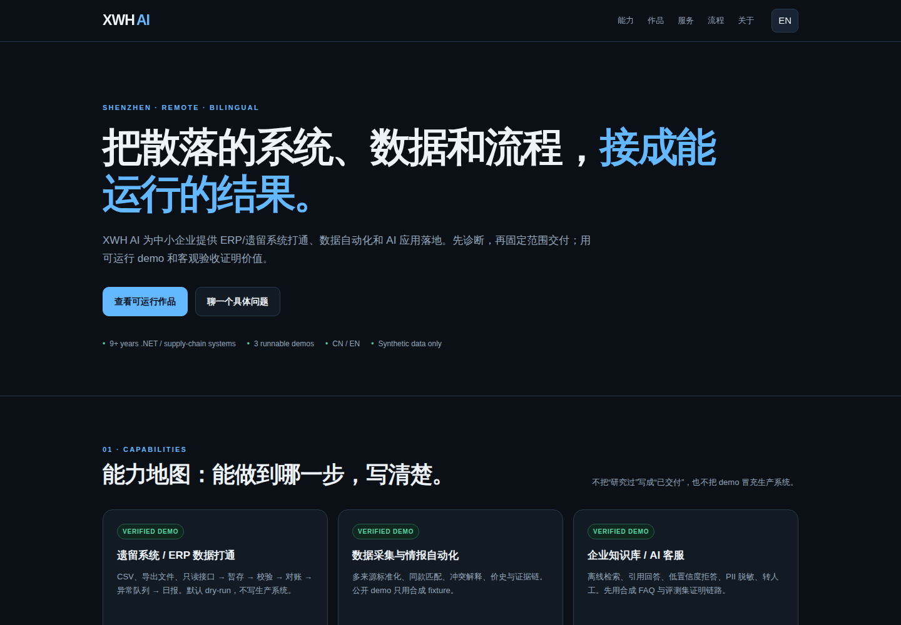

# XWH AI Automation Showcase

**Bilingual, synthetic-data demos for enterprise integration, data automation, and AI support.**
**企业系统打通、数据自动化与 AI 客服的双语合成数据作品集。**

> No real customer data, credentials, or production systems are used.
> 全部使用合成数据，不连接真实客户、凭据或生产系统。

## Live site / 线上状态

- Production: https://xwh-ai-showcase.pages.dev/
- Deployment ID: `c8b600bd-3314-4b49-839e-1a1e070ab605` (source `e18109f`)
- Global browser checks passed; mainland China three-network gate has **not** passed.
- 全球浏览器验收通过；中国大陆三网两地点硬闸**未通过**，当前不宣称国内稳定访问。
- Full status and evidence: [docs/production-status.md](docs/production-status.md)

## Demos

- `demos/legacy-bridge/` — Legacy order bridge: CSV → staging → reconciliation → exceptions → daily report.
  遗留订单桥：CSV → 暂存 → 对账 → 异常队列 → 日报。
- `demos/price-console/` — Evidence-first price console with source, timestamp, confidence, and conflict handling.
  有证据的价格情报台：来源、时间、置信度与冲突处理。
- `demos/ai-support/` — Offline knowledge-base support prototype with citations, refusal, PII redaction, and human handoff.
  离线知识库客服原型：引用、拒答、PII 脱敏与转人工。

## Verification / 验证

| Demo | Tests / 测试 | Browser / 浏览器 | Video / 视频 |
|---|---|---|---|
| Legacy Bridge | 35/35 .NET tests | Desktop + mobile, 0 console errors | [MP4 · 53s](demos/legacy-bridge/verification/demo.mp4) |
| Price Console | 22/22 Node tests; 20 blind probes | 4/4 scenarios, 0 external requests | [MP4 · 69s](demos/price-console/verification/demo.mp4) |
| AI Support | 14/14 Node tests; 30-question eval | Desktop + 390px mobile, 0 console errors | [MP4 · 54s](demos/ai-support/results/demo.mp4) |

All metrics describe fixed synthetic datasets, not production accuracy.
  所有指标只描述固定合成数据集，不代表生产准确率。

## Run locally

Each demo has its own README with exact commands. The company site is the root [`index.html`](index.html).

## Status legend

- **Verified demo** — runnable and covered by fixed samples/tests.
  **已验证 demo** — 可运行并有固定样例/测试。
- **Scope before delivery** — capability can be scoped, but no production claim is made.
  **需先评估** — 可评估承接，但不作生产能力承诺。
- **Experimental** — not offered as a production capability.
  **实验性** — 不作为生产能力承诺。

## License

Code, documentation, and synthetic datasets: MIT. Third-party components retain their own licenses.
