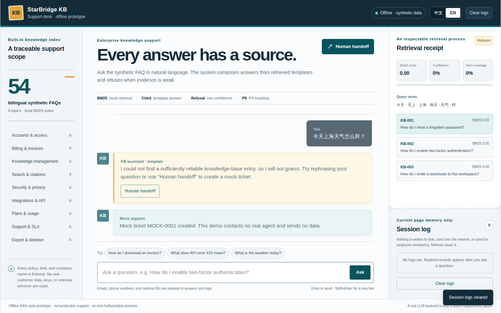
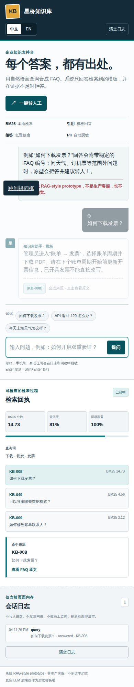

# 离线企业知识库客服原型 · Offline Enterprise KB Support Prototype

**星桥知识库 / StarBridge KB** 是一个双语、全合成、可评测的离线 RAG-style prototype。它使用本地 BM25 检索内置 FAQ，以检索到的模板组成回答，并为每个回答附带稳定引用；证据不足时拒答并建议转人工。

**StarBridge KB** is a bilingual, fully synthetic, evaluable offline RAG-style prototype. It retrieves built-in FAQs with local BM25, composes answers from retrieved templates, and attaches a stable citation to every answer. It refuses when evidence is weak and offers a mock human handoff.

> **不是生产客服，不承诺零幻觉。** 不调用真实模型、真实客户数据、密钥或外部服务。真实 LLM 后端仅可作为后续替换项。
>
> **Not production support. No zero-hallucination promise.** No real model, customer data, credentials, or external service is used. A real LLM backend is only a future replacement option.

## 1. 运行 · Run

要求 / Requires: Node.js 20+，无需 `npm install`。 / Node.js 20+; no `npm install` is needed.

```bash
cd demos/ai-support
node server.mjs
```

打开 / Open <http://127.0.0.1:4173>。默认只监听本机。可用 `PORT` 和 `HOST` 覆盖：

```bash
PORT=8080 HOST=127.0.0.1 node server.mjs
```

请通过静态服务器访问，不要直接用 `file://` 打开：浏览器会因 ES module 的本地文件策略阻止加载。 / Use the static server rather than `file://`, which browsers block for local ES modules.

静态服务器由 [`server.mjs`](./server.mjs) 提供，不调用外部 API。页面设置 CSP `connect-src 'none'`，所有 CSS、JS、图标和数据均从本地加载。 / [`server.mjs`](./server.mjs) calls no external API. The page uses CSP `connect-src 'none'`; CSS, JS, icons, and data are local.

也可以使用脚本入口 / Script entry points:

```bash
npm start
npm test
npm run eval
```

## 2. 页面与交互 · UI and Interactions

- 单页应用：一个 HTML 页面加本地 CSS/JS modules。 / One HTML page with local CSS/JS modules.
- 中英切换：界面、FAQ 回答、拒答提示和检索回执同步切换；已有回答按新语言重新生成。 / The UI, FAQ answers, refusal copy, and retrieval receipt switch together; existing answers are regenerated in the new language.
- 回答引用：每个已回答消息显示 `[KB-xxx]`，点击可打开合成 FAQ 原文。 / Every answered message shows `[KB-xxx]`; open it to inspect the synthetic FAQ source.
- 低置信度拒答：范围外或证据不足的问题不生成猜测答案。 / Out-of-scope or weakly supported questions receive no guessed answer.
- 一键转人工：创建 `MOCK-xxxx` 模拟工单，不发网络请求、不联系真实客服。 / One-click human handoff creates a `MOCK-xxxx` ticket without network requests or a real agent.
- PII 脱敏：邮箱、中国大陆手机号、18 位身份证号在回答和日志中替换为 `[email]`、`[phone]`、`[id]`。 / Emails, mainland China mobile numbers, and 18-digit national IDs become `[email]`, `[phone]`, and `[id]` in answers and logs.
- 会话日志：只存当前页面内存，最多 100 条；“清空日志”只清日志，不清聊天。刷新页面会清空日志和聊天。 / Logs live only in current-page memory, capped at 100 entries. “Clear logs” clears logs, not chat; refresh clears both.
- 不做员工监控：没有分析上报、员工级追踪或持久化存储。 / No analytics reporting, employee-level tracking, or persistent storage.

## 3. 架构 · Architecture

```text
Browser
  index.html
  src/styles.css
  src/app.js ───────────────┐
                           ▼
                   src/engine.mjs ──────► src/faqs.mjs
                   BM25 + gating          54 bilingual FAQs
                   PII + log helpers
                           ▲
                           │
  eval.mjs ────────────────┘
  src/eval-cases.mjs ───────┘
  30 fixed synthetic questions
                           │
                           ▼
              results/eval-results.json
              results/eval-results.md
```

| 文件 / File | 职责 / Responsibility |
| --- | --- |
| [`index.html`](./index.html) | 单页结构、可访问语义、本地资源入口 / Single-page structure, accessible semantics, local asset entry |
| [`src/styles.css`](./src/styles.css) | 桌面三栏、移动端堆叠、焦点态、减少动态效果 / Desktop three-column layout, mobile stacking, focus states, reduced motion |
| [`src/app.js`](./src/app.js) | 双语 UI、聊天、引用弹窗、检索回执、内存日志、模拟转人工 / Bilingual UI, chat, citation dialog, retrieval receipt, memory logs, mock handoff |
| [`src/engine.mjs`](./src/engine.mjs) | BM25、分词、置信度门控、模板回答、引用校验、PII 脱敏 / BM25, tokenization, confidence gates, template answers, citation validation, PII masking |
| [`src/faqs.mjs`](./src/faqs.mjs) | 54 条中英文合成 FAQ，9 个主题 / 54 bilingual synthetic FAQs across 9 topics |
| [`src/eval-cases.mjs`](./src/eval-cases.mjs) | 30 道固定合成评测题：20 道可答、10 道范围外 / 30 fixed synthetic cases: 20 answerable, 10 out of scope |
| [`eval.mjs`](./eval.mjs) | 执行评测、计算指标、保存 JSON/Markdown / Run evaluation, compute metrics, save JSON/Markdown |
| [`test/engine.test.mjs`](./test/engine.test.mjs) | Node 内置测试：检索、引用、拒答、PII、日志 / Node built-in tests for retrieval, citations, refusal, PII, and logs |
| [`server.mjs`](./server.mjs) | 无依赖静态服务器与安全响应头 / Dependency-free static server and security headers |
| [`package.json`](./package.json) | 本地脚本入口 / Local script entry points |

### 检索与回答 · Retrieval and Answering

1. 输入先做 PII 脱敏；PII 标记不参与检索意图打分。 / Input is masked first; PII markers do not dominate retrieval intent.
2. 中文使用 Han bigrams，英文使用轻量词干化；索引同时包含中英文问题、答案、关键词和分类。 / Han text uses bigrams, English uses light stemming, and the index includes both languages' questions, answers, keywords, and categories.
3. BM25 参数为 `k1=1.5`、`b=0.75`。 / BM25 uses `k1=1.5` and `b=0.75`.
4. 只有同时满足以下门槛才回答：BM25 ≥ `7`、IDF 加权词项覆盖 ≥ `0.12`、组合置信度 ≥ `0.6`。 / An answer requires BM25 ≥ `7`, IDF-weighted term coverage ≥ `0.12`, and combined confidence ≥ `0.6` at the same time.
5. 回答文本直接取命中 FAQ 的对应语言模板，并追加 `[KB-xxx]`；不拼接模型生成文本。 / Answer text is the cited FAQ's localized template plus `[KB-xxx]`; no model-generated text is composed.

组合置信度是透明、可解释的词法启发式，**不是校准后的概率**。 / Combined confidence is a transparent lexical heuristic, **not a calibrated probability**.

## 4. 测试与评测 · Tests and Evaluation

### Node 内置测试 · Node Built-in Tests

```bash
node --test
```

当前覆盖 14 项测试，全部通过： / The suite currently has 14 passing tests covering:

- 54 条 FAQ 的完整性、唯一性和双语字段 / FAQ completeness, uniqueness, and bilingual fields
- 30 道评测题的固定构成 / Fixed 30-case evaluation composition
- 中英文分词与 BM25 命中 / Chinese/English tokenization and BM25 hits
- 跨语言检索与本地化模板 / Cross-language retrieval and localized templates
- 回答模板、引用编号与引用校验 / Answer templates, citation IDs, and citation validation
- 范围外拒答、空/无关索引拒答 / Out-of-scope refusal and empty/unrelated-index refusal
- 邮箱、手机号、身份证号及嵌套日志脱敏 / Email, phone, national ID, and nested-log masking
- 内存日志上限与无效引用拒绝 / In-memory log cap and invalid-citation rejection
- 30 道固定题的端到端期望行为 / Expected end-to-end behavior for all 30 fixed cases

### 30 题评测 · 30-Question Evaluation

```bash
node eval.mjs
```

脚本使用与浏览器相同的引擎，保存 30 题逐题原始结果到 [`results/eval-results.json`](./results/eval-results.json) 和 [`results/eval-results.md`](./results/eval-results.md)。输入以脱敏形式保存；合成 PII 不会写入结果文件。 / The script uses the same engine as the browser and saves all 30 per-question results to [`results/eval-results.json`](./results/eval-results.json) and [`results/eval-results.md`](./results/eval-results.md). Inputs are saved masked so synthetic PII is not written into result files.

| 指标 / Metric | 定义 / Definition | 当前结果 / Current |
| --- | --- | ---: |
| Accuracy | 可答题命中期望 FAQ 或范围外题正确拒答 / Correct FAQ hit or correct out-of-scope refusal | **100.0%** |
| Answerable accuracy | 20 道可答题的正确命中率 / Correct hits among 20 answerable cases | **100.0%** |
| Refusal correctness | 10 道范围外题的正确拒答率 / Correct refusals among 10 out-of-scope cases | **100.0%** |
| Hallucination rate | 已回答中引用无效或文本偏离对应 FAQ 模板的比例 / Answered cases with invalid citation or text differing from the cited FAQ template | **0.0%** |
| 无引用率 / Uncited-answer rate | 已回答中无有效引用的比例 / Answered cases without a valid citation | **0.0%** |
| PII 泄漏数 / PII leak count | 回答、内存日志和结果对象中的受支持 PII 模式数 / Supported PII patterns in answers, memory logs, and result objects | **0** |

这些数字只说明固定合成集上的可重复行为，不代表生产准确率。 / These numbers describe reproducible behavior on a fixed synthetic set, not production accuracy.

## 5. 验收记录 · Acceptance Record

| 要求 / Requirement | 证据 / Evidence | 状态 / Status |
| --- | --- | --- |
| 单页、离线、无 CDN / Single page, offline, no CDN | 本地 modules；CSP `connect-src 'none'`；浏览器外部请求为 0 / Local modules; CSP; 0 external browser requests | 通过 / Pass |
| ≥50 条中英文合成 FAQ / ≥50 bilingual synthetic FAQs | [`src/faqs.mjs`](./src/faqs.mjs) 共 54 条 / 54 entries | 通过 / Pass |
| 30 题评测与原始结果 / 30 cases and raw results | [`results/eval-results.json`](./results/eval-results.json)、[`results/eval-results.md`](./results/eval-results.md) | 通过 / Pass |
| BM25、模板回答、引用 / BM25, template answers, citations | 14 项 Node 测试；0 无引用率 / 14 Node tests; 0% uncited rate | 通过 / Pass |
| 低置信度拒答 / Low-confidence refusal | 10/10 范围外题正确拒答 / 10/10 out-of-scope cases correctly refused | 通过 / Pass |
| PII 脱敏与内存日志 / PII masking and memory logs | 合成 PII 测试；日志清空后计数为 0 / Synthetic PII tests; log count 0 after clear | 通过 / Pass |
| 一键转人工 mock / One-click mock handoff | 浏览器观察到 `MOCK-0001`，无外部请求 / Browser observed `MOCK-0001`; no external requests | 通过 / Pass |
| 桌面 1440×900 无溢出 / Desktop 1440×900 no overflow | 交互前后 `scrollWidth = clientWidth = 1440`，`scrollHeight = clientHeight = 900` | 通过 / Pass |
| 390px 手机无横向溢出 / 390px mobile no horizontal overflow | `scrollWidth = clientWidth = 390`，越界元素为 0；纵向滚动为预期行为 / `scrollWidth = clientWidth = 390`; 0 out-of-bounds elements; vertical scrolling is expected | 通过 / Pass |
| 0 控制台错误 / 0 console errors | Playwright 独立会话 `ai-support`；`consoleErrors: []` / Isolated Playwright session; `consoleErrors: []` | 通过 / Pass |

浏览器原始记录见 [`results/browser-validation.json`](./results/browser-validation.json)。 / Raw browser evidence is in [`results/browser-validation.json`](./results/browser-validation.json).

### Demo video / 演示视频

- [MP4 · 54 seconds](./results/demo.mp4)
- [WebM · 54 seconds](./results/demo.webm)
- [Lightweight GIF preview](./results/demo-preview.gif)
- [Recording script](./results/record-demo.js)

桌面截图 / Desktop screenshot:



390px 手机截图 / 390px mobile screenshot:



## 6. 限制 · Limitations

- **词法检索而非语义理解 / Lexical retrieval, not semantic understanding.** 委婉表达、跨语言同义改写或错别字可能漏检；阈值在这 30 道固定题上校准，没有统计显著性保证。 / Paraphrases, cross-language synonyms, or typos may be missed. Thresholds are tuned on 30 fixed cases without a statistical significance guarantee.
- **引用指向合成 FAQ / Citations point to synthetic FAQs.** 没有真实文档 URL、权限系统或实时知识更新。 / There are no real document URLs, permission system, or live knowledge updates.
- **PII 规则有限 / PII rules are limited.** 只覆盖邮箱、中国大陆手机号和 18 位身份证号；不覆盖姓名、地址、国际号码、护照、密钥或所有变形。生产前需要专门检测与人工审核。 / Only emails, mainland China mobile numbers, and 18-digit national IDs are covered. Names, addresses, international numbers, passports, keys, and many variants are not. Production needs dedicated detection and review.
- **日志不是审计系统 / Logs are not an audit system.** 仅在内存中保留最多 100 条，刷新即丢失，不能用于合规审计。 / Logs are in-memory only, capped at 100 entries, and lost on refresh; they are not a compliance audit trail.
- **转人工是 mock / Handoff is a mock.** 不会创建真实工单、通知客服或发送数据。 / It creates no real ticket, notifies no agent, and sends no data.
- **没有生产控制 / No production controls.** 缺少身份认证、RBAC、多租户隔离、速率限制、恶意输入防护和 SLA。 / Authentication, RBAC, multi-tenant isolation, rate limiting, abuse protection, and SLAs are absent.
- **不承诺零幻觉 / No zero-hallucination promise.** 即使引用有效，FAQ 内容本身也可能过时或不完整；引用校验不是事实正确性保证。 / Even a valid citation can point to stale or incomplete FAQ content; citation validation is not a factual-correctness guarantee.

## 7. 后续替换真实 LLM · Future Real-LLM Replacement

替换点应保持为 `answerQuestion(query, { lang })` 接口：真实后端可以在相同输入下返回带文档 ID、权限校验结果和置信度的候选，再由上层统一渲染引用、拒答、PII 脱敏和模拟/真实转人工。 / A future backend can preserve the `answerQuestion(query, { lang })` interface, returning candidates with document IDs, permission checks, and confidence while the UI keeps unified citation, refusal, PII, and handoff behavior.

上线前至少还要补充：真实数据授权、文档级权限、PII 服务、提示注入防护、人工审核、离线/在线混合评测、监控与隐私影响评估。 / Before production, add data authorization, document-level permissions, a PII service, prompt-injection defenses, human review, hybrid offline/online evaluation, monitoring, and a privacy impact assessment.
